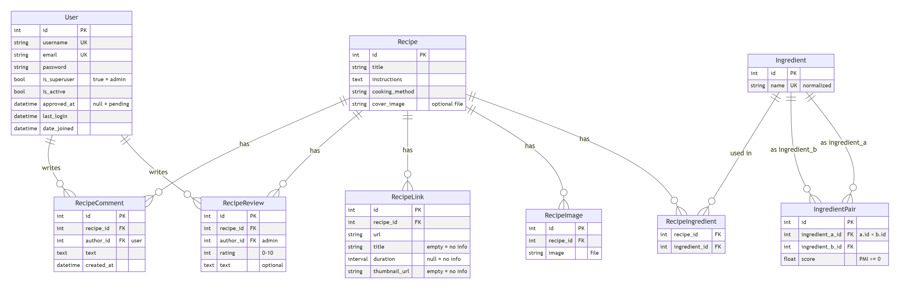
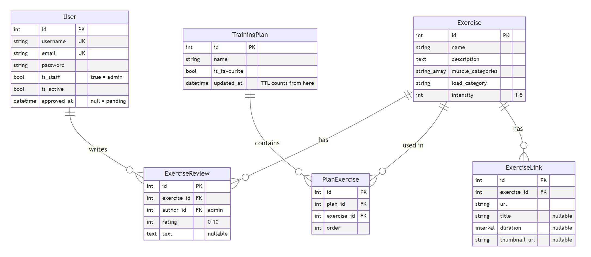

## Roles

- ADMIN: both team members (Django superusers, created by hand), full access to everything
- USER: can view everything and leave comments on recipes. Signs up with username, email and own password; account
  stays inactive until an admin approves it
- randomizers are admin-only
- user statuses: pending (not approved yet), active, banned. Rejecting a sign-up deletes the account. Admins can't be
  banned or deleted (neither through the API nor in the Django admin panel)

## Auth

- JWT: access token 15 min, refresh token 7 days; each refresh gives a new refresh token and the old one stops
  working; logout invalidates the refresh token. Banning blocks a user's existing tokens immediately
- endpoints: `/api/v1/auth/register/`, `login/`, `refresh/`, `logout/`, `me/`
- sign-up checks the password confirmation and Django's password rules
- a pending or banned user who logs in with the correct password gets a clear "waiting for approval" / "banned"
  message; a wrong password gets a generic error
- rate limits per IP: login 5/min, sign-up 5/hour
- user management (admins): `/api/v1/users/` lists regular users (admins hidden), `?status=pending|active|banned`,
  actions approve / reject / ban / unban, each allowed only in the matching status. Same actions in the Django admin
  panel
- API docs (Swagger) at `/api/docs/`, admins only (log in at `/admin/` first)

## Common

- rating: integer 0-10, personal for each admin. Shown per admin (by username) plus a combined rating = average of
  the given ratings; lists can be sorted by any admin's rating or the combined one (unrated last). Visible to everyone
- review: rating + optional text, personal for each admin. Same for recipes, games and exercises. An admin creates
  their review with `POST .../{id}/review/`, edits it with `PATCH`, removes it with `DELETE`. A second `POST` by the
  same admin gives 409. `POST`/`PATCH` return just the review. Text up to 2,000 characters. Reviews are listed in the
  same admin order as the per-admin ratings
- links: any site; only YouTube links get metadata from YouTube API (title, duration, `high` thumbnail), fetched for
  all links of a request in one call
    - `POST .../{id}/links/` with `{"links": [...]}` adds several at once and returns the new links;
      `DELETE .../{id}/links/{link_id}/` removes one
    - a broken YouTube link (no video id, video not found) rejects the whole request, nothing saved; errors point to the
      link's position: `{"links": {"1": ["YouTube video not found."]}}`
    - a link already added, or repeated in the request, is saved once without an error
    - YouTube down (timeout, server error, quota used up): saved without info. Invalid or forbidden API key: error
      503, nothing saved
    - missing info is filled in by admins with a button (no scheduler: the free host has no cron jobs):
      `POST .../{id}/links/refresh/` for one object returns `{"links": [all its links], "not_found": [link ids]}`;
      `POST /links/refresh/` for every link returns
      `{"filled": n, "not_found": [{"url": ..., "type": "recipe", "object_id": 12}]}`. Links whose video was removed
      from YouTube stay without info and are listed in `not_found`. YouTube still down gives 503 and nothing changes

## Recipes

- title
- instructions (full recipe text, including ingredient amounts)
- cooking_method, one per recipe: BAKED, FRIED, BOILED, STEWED, GRILLED, STEAMED, RAW, OTHER
- links
- ingredients (no amounts, those are in instructions); at least one per recipe; an ingredient used in a recipe can't
  be deleted
- cover image: own optional field, replaced by uploading a new one
- gallery images: several, added at once and removed one by one, no limit on count
- review
- comments: from users only, no editing; author deletes own, admins delete any; newest first; up to 2,000
  characters

### Recipes API

- `POST /recipes/` (form data or JSON): title, instructions, cooking method, ingredient IDs, optional cover, optional
  list of links. A broken link means the recipe isn't created
- `PATCH /recipes/{id}/` edits the same fields except links; uploading a cover replaces the old one, an empty value
  removes it. No PUT
- list: id, title, cooking method, cover, ratings per admin, combined rating. Newest first by default;
  `?ordering=combined_rating` or `rating:<admin username>` (`-` for highest first); `?search=` looks in title and
  instructions, title matches first; filters `?cooking_method=`, `?ingredient=<id>`
- detail adds instructions, ingredients, gallery images, links, reviews, comment count
- images (cover and gallery): max 5 MB; HEIC refused with a clear message (convert to JPEG/PNG)
- gallery: `POST /recipes/{id}/images/` (files under `images`) returns the new images, one bad file saves none (and a
  failed save leaves no files behind); `DELETE /recipes/{id}/images/{image_id}/`
- deleting a recipe or an image, or replacing the cover, deletes the file from disk
- comments: `GET /recipes/{id}/comments/` (all of them, no pages), `POST` the same URL (regular users only) returns the
  new comment, `DELETE /recipes/{id}/comments/{comment_id}/`. A banned user's comments stay. In the Django admin panel
  comments can only be viewed and deleted

## Ingredients

- name
- filled once from RecipeNLG by a management command; admins can add missing ones by hand
- search for the recipe form (and the recipe list filter): `GET /ingredients/?search=`, any logged-in user. Names
  containing the typed text, case-insensitive; names starting with it first, then shorter names first, then
  alphabetical; at most 20 results. Fewer than 2 characters or no `search` gives an empty list
- `POST /ingredients/` and `DELETE /ingredients/{id}/`: admins only. Adding a name that already exists gives 400 on
  `name`; deleting an ingredient used in a recipe gives 409 with the number of recipes. Renaming only in the Django
  admin panel
- names added by hand (API or Django admin panel) get basic cleanup (lowercase, trimmed, single spaces). Imported
  names come from the reviewed names file (see Ingredient Pairs)

### Ingredient Pairs

- ingredient_a, ingredient_b (each pair stored once, smaller id first)
- score (PMI, see Randomizers); computed only from RecipeNLG, our own recipes are too few. PMI can be negative (two
  ingredients meet less often than chance); only pairs with a score of 0 or more are stored
- import: `python manage.py import_recipenlg <csv>`. Re-running it replaces all pairs and never deletes ingredients
- which RecipeNLG names are imported comes from `recipes/recipenlg_names.csv`, reviewed by hand once: every name used
  in at least 100 recipes (rarer ones are mostly junk), mapped to the ingredient it means (`fresh basil` -> `basil`,
  `kosher salt` -> `salt`, `mayonnais` -> `mayonnaise`) or marked as junk (`ground`, `for sauce`, `baking dish`).
  Names not in the file are skipped, so the list stays clean on every run; a new name needs a new row. A hand-added
  ingredient gets pairs only if the file maps some RecipeNLG name to it
- a pair must appear together in at least 10 recipes (fewer gives scores driven by luck)
- rejected alternatives: cleanup rules alone (left ~9% junk), a food dictionary as a whitelist (drops real ingredients
  it lacks). Kept as a fallback: parsing the raw ingredient lines with a recipe parser (see `recipes/recipenlg.py`)

## Games

- added only from RAWG API (cover, description, genres, release date, RAWG rating up to 5). Cover, genres, release
  date and rating can be missing; RAWG's rating 0 means no rating
- RAWG data keeps its values from when the game was added; admins update it with a refresh button for one game (detail
  page) or all games (list page). A refresh copies name, description, cover, release date, rating and genres, clearing
  what RAWG no longer has, and never touches categories, statuses or reviews
- RAWG's free plan requires a visible, active link to RAWG on every frontend page that shows its data (games pages
  only); placement and wording are free
- categories: SOLO, COOP, MULTIPLAYER. Set by admins by hand; a game has at least one and can have several
- status: PLANNED, DROPPED, PLAYING, COMPLETED. One per admin per game, whatever its categories (coop games are often
  played solo)
- review

### Games API

- `GET /games/search/?q=` (admins, at least 2 characters): top 10 RAWG results with `rawg_id` (hidden in the UI, sent
  back to add the game), `game_id` (our game's id if already added, otherwise null), name, cover, release date, RAWG
  rating and genre names
- `POST /games/` with `{"rawg_id": 4200, "categories": ["SOLO"]}` (admins) returns the new game. An already added game
  (including a double-click) gives 409 with its `game_id`; a game RAWG doesn't have gives 400 on `rawg_id`
- list: id, name, cover, release date, RAWG rating, categories, genres, statuses per admin
  (`{"<admin username>": "PLAYING", "<other admin username>": null}`), ratings per admin, combined rating (sent for the
  frontend, which doesn't display it or the id). Newest first by default. Detail adds description and reviews
- list options, one value each: `?genre=<id>`, `?category=`, `?search=` (name), `?status=` (any admin has it), `?admin=`
  (with `status`, that admin has it; alone, that admin has any status; unknown admin gives 400),
  `?ordering=rawg_rating`, `combined_rating` or `rating:<admin username>` (`-` for highest first, unrated last)
- `GET /games/genres/`: genres that at least one game has, by name
- `PATCH /games/{id}/` with `{"categories": [...]}` (admins) returns the game; `DELETE /games/{id}/` (admins) also
  removes its statuses and reviews
- `PUT /games/{id}/status/` with `{"status": "PLAYING"}` (admins) sets or changes the admin's own status and returns it;
  `DELETE` clears it and gives 204 even if there was none. Reviews work on a game with any status or none
- `GET /games/random/?status=&status_scope=mine|both&genre=&category=` (admins) returns a random game in the detail
  shape. `status` and `status_scope` are required, genre and category optional. Nothing matching gives 404, an unknown
  genre gives 400
- `POST /games/{id}/refresh/` (admins) returns `{"game": {...}, "not_found": false}`; `POST /games/refresh/` (admins)
  returns `{"updated": 12, "not_found": [{"id": 5, "name": "Portal"}]}` and sends one RAWG request per game. A game RAWG
  no longer has stays unchanged and is reported in `not_found`
- RAWG failures save nothing and answer 503 with a `detail` saying what went wrong: timeout, unavailable, API key
  rejected or request limit used up

## Training

### Exercises

- name
- text description
- links (see Exercise Links)
- muscle_categories: an exercise can have several. CHEST, BACK, SHOULDERS, ARMS, CORE, LEGS (basic set, to be expanded)
- load_category: weight load. BODYWEIGHT, LIGHT, MEDIUM, HEAVY (basic set, to be expanded)
- intensity: general complexity, 1-5
- review
- archived_at: null means active. Exercises are never deleted, only archived (a soft delete), so stored plans stay
  complete. Admins can restore an archived exercise
- an archived exercise is read-only: still shown in existing plans, hidden from the randomizer, can't be changed or
  added to a plan, and its reviews and attached links can't be added, edited or removed. YouTube info refresh still
  updates its links, since they are shared. A plan containing one can't be edited until the exercise is restored, but
  it can still be added to or removed from favourites
- changing an exercise's fields is allowed even when stored plans use it

### Exercise Links

- ExerciseLink: url (unique), title, duration, thumbnail_url. One row per URL: an exercise can come from several
  sources (video, web page) and one source can cover several exercises
- ExerciseExerciseLink: many-to-many relation between exercises and links
- YouTube info follows the Common link rules and is stored on ExerciseLink, so it is fetched once per URL
- detaching a link from an exercise removes only the relation; the ExerciseLink row stays and can be reused
- `POST /links/refresh/` lists a removed video once per exercise using it, each entry with one `url` and one `object_id`

### Training Plan

- name
- ordered list of exercises (no sets/reps)
- created only when the plan is saved on the frontend
- immutable: editing a plan creates a new plan with its own created_at and leaves the original unchanged, which also
  covers reordering
- source_plan: the plan it was copied from, null for a brand-new plan
- user: who built it, nullable
- mode: how it was built. RANDOM, RANDOM_EDIT, MANUAL
- favourites: admins only, personal for each admin, stored in UserFavouritePlan. Adding or removing one doesn't create
  a new plan, and a new plan never inherits favourites from its source
- plans are kept for future dashboards, analysis and randomizer recommendations: there is no delete endpoint and
  nothing deletes them automatically
- workout sessions are not stored

## Randomizers

- food randomizer. 2 modes:
    - NAIVE picks random ingredients
    - SMART builds a coherent combination using ingredient pair scores:
        - scores come from how often 2 ingredients appear together in RecipeNLG recipes (~2.2M) compared to chance:
          `PMI = log(recipes with both / expected by chance)`, where expected = recipes with A * recipes with B /
          all recipes
        - rare pairs are ignored (thresholds chosen from measurements on the data)
        - the next ingredient must have a stored pair with every chosen ingredient that has pairs; it is picked
          randomly, weighted by its average score with chosen ones; too low averages are dropped
        - ingredients without scores are never picked by SMART
    - `GET /ingredients/random/`, admins only. `mode=naive|smart` (required), `size` 2-20 (default 5),
      `include=<id>,<id>` optional starting ingredients (both modes; counted in `size`). Returns
      `{"ingredients": [{"id", "name"}]}`; SMART may return fewer than `size` when nothing else fits
    - SMART without `include` starts from a random ingredient that has pairs. Starting ingredients without pairs (e.g.
      added by hand) stay in the result but don't block candidates; if none of them has pairs, SMART also starts from a
      random ingredient that has pairs
    - result order: the `include` ingredients as given, then the picked ones in pick order. An id given twice counts
      once
    - 400 on the field: missing or unknown `mode`, `size` out of range, unknown `include` id, more `include` ids than
      `size`
- games randomizer. Random game based on GENRE, CATEGORY and a required STATUS (any of the four); the status is
  either mine or the same for both admins
- training plan randomizer. Pre-fills a new plan in the editor with a given number of exercises chosen by
  MUSCLE_CATEGORY, LOAD_CATEGORY, INTENSITY; saving works like a regular plan

## Logging

- everything goes to the console; the level comes from `LOG_LEVEL` (DEBUG, INFO, WARNING, ERROR; default INFO).
  Server errors are logged with their traceback whether DEBUG is on or off
- logged events: YouTube unavailable (warning, with the reason: links saved without info, or refresh failed), YouTube
  API key rejected (error), links whose video was removed (info), user approved / rejected / banned / unbanned with
  the admin who did it (info), failed login with username, client address and reason (warning), rate limit hit with
  the endpoint and client address (warning), RAWG timeout, unavailable or limit reached (warning), RAWG API key rejected
  (error)

## Database diagram

### Recipes

### Games

### Training

Unique together: IngredientPair (ingredient_a, ingredient_b); each review (target, author); GameStatus (game, user);
PlanExercise (plan, order); ExerciseExerciseLink (exercise, link); UserFavouritePlan (user, plan). RecipeIngredient and
GameGenre are many-to-many join tables created by Django.
