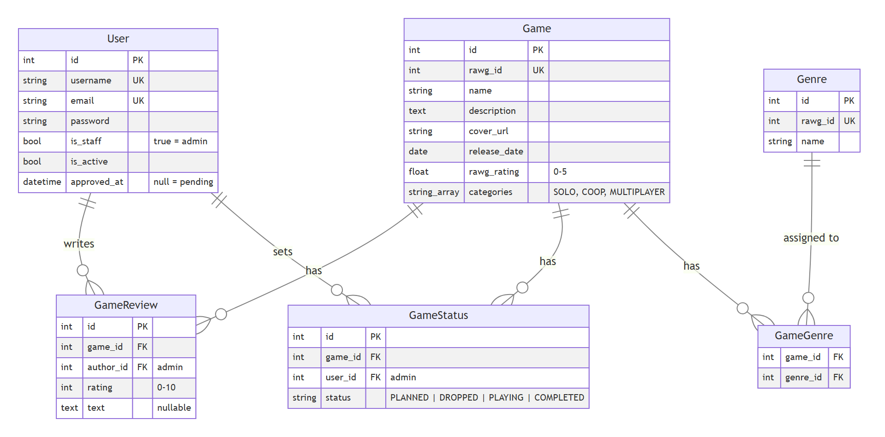

## Roles

- ADMIN: both team members, full access to everything
- USER: can view everything and leave comments on recipes. Signs up with username, email and own password; account
  stays inactive until an admin approves it
- randomizers are admin-only

## Common

- rating: integer 0-10, personal for each admin
- review: rating + text, personal for each admin. Same for recipes, games and exercises
- links (youtube, reels, threads, tiktok): only YouTube links get metadata from YouTube API (title, duration,
  thumbnail), others are stored as plain links. A wrong YouTube link shows a message on that link; YouTube being down
  must not block saving

## Recipes

- instructions (full recipe text, including ingredient amounts)
- cooking_method (BAKED, FRIED, etc.), one per recipe
- links
- ingredients (no amounts, those are in instructions)
- image
- review
- comments: from users only, no editing; author deletes own, admins delete any

## Ingredients

- name
- filled once from RecipeNLG by a management command; admins can add missing ones by hand

### Ingredient Pairs

- ingredient_a, ingredient_b
- score (PMI, see Randomizers)

## Games

- added only from RAWG API (cover, description, genre, release date, RAWG rating 0-5)
- categories: SOLO, COOP, MULTIPLAYER. A game can have several
- status: PLANNED, DROPPED, PLAYING, COMPLETED. Personal for each admin, for every category (coop games are often
  played solo)
- review

## Training

### Exercises

- text description
- links
- muscle_categories: an exercise can have several
- load_category (ENUM): weight load
- intensity: general complexity
- review

### Training Plan

- ordered list of exercises (no sets/reps)
- created only when the plan is saved on the frontend; existing plans can be loaded and edited
- is_favourite: shared for both admins. Plans that are not favourite get deleted automatically 30 days after their
  last edit
- workout sessions are not stored

## Randomizers

- food randomizer. 2 modes:
    - NAIVE picks random ingredients
    - SMART builds a coherent combination using ingredient pair scores:
        - scores come from how often 2 ingredients appear together in RecipeNLG recipes (~2.2M) compared to chance:
          `PMI = log(recipes with both / expected by chance)`, where expected = recipes with A * recipes with B /
          all recipes
        - pairs seen together in fewer than ~20 recipes are ignored
        - the next ingredient must not have a negative score with any chosen ingredient; it is picked randomly,
          weighted by its average score with chosen ones; too low scores are dropped
        - ingredients without scores are never picked by SMART
- games randomizer. Random game based on GENRE and STATUS; status is either mine or the same for both admins
- training plan randomizer. Pre-fills a new plan in the editor with a given number of exercises chosen by
  MUSCLE_CATEGORY, LOAD_CATEGORY, INTENSITY; saving works like a regular plan

## Database diagram

### Recipes

### Games

### Training

Unique together: IngredientPair (ingredient_a, ingredient_b); each review (target, author); GameStatus (game, user);
PlanExercise (plan, order). RecipeIngredient and GameGenre are many-to-many join tables created by Django.
